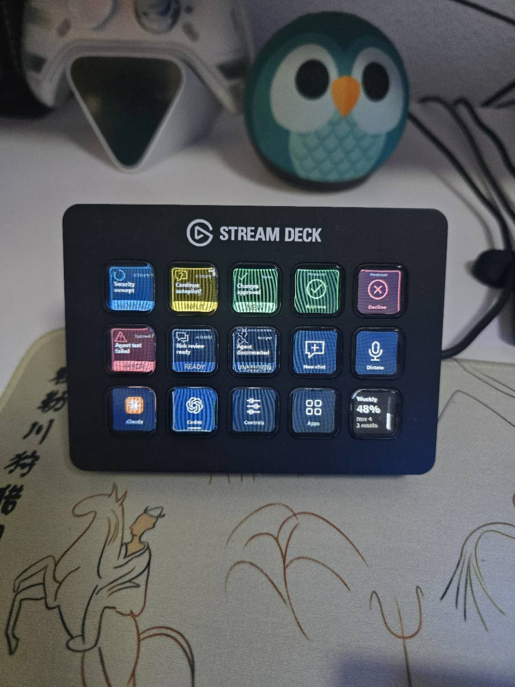
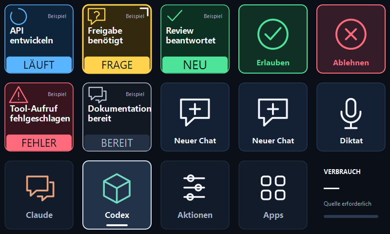

<div align="center">

# Cardea Deck

### Your agents. One place.

Claude and Codex on your Stream Deck — see who is working, who needs you, and who has an answer.

[](https://github.com/Giugiu8/cardea-deck/releases/tag/v0.8.0-beta.1)
[](https://github.com/Giugiu8/cardea-deck/actions/workflows/check.yml)
[](LICENSE)

**[Download Stream Deck plugin](https://github.com/Giugiu8/cardea-deck/releases/download/v0.8.0-beta.1/Cardea-Deck-0.8.0.streamDeckPlugin)** · **[German installation guide](docs/INSTALL-DE.md)** · [How it works](#controls)

</div>

Experimental Windows beta for the **15-key Stream Deck MK.2**. Independent community project; not affiliated with Anthropic, OpenAI, Elgato or Work Louder. [German guide for installation on a second PC](docs/INSTALL-DE.md).

**Why it exists:** Inspired by [Codex Micro](https://learn.chatgpt.com/docs/features/codex-micro). Buying another device wasn't in my budget, so I built this for the Stream Deck I already owned.

<p align="center">
  
  <br>
  <sub>Real hardware: English demonstration layout with sample security tasks. Codex usage was live when photographed.</sub>
</p>

<details>
<summary>Explore the key layout and status colors</summary>



*Illustrative layout with English sample tasks. The installed plugin uses real local sources or an explicit unknown state.*

</details>

| See it | Open it | Decide |
|---|---|---|
| Large status labels show work, questions and new answers. | Press a chat key to jump to the conversation. | Answer a supported request for the selected chat. |

Same positions for both providers. Six chats per page. Navigation stays **Claude · Codex · Controls · Apps**. Your app shortcuts live on their own page.

No cloud telemetry or account keys required by Cardea Deck. Setup preserves existing Claude hooks and custom status lines; local state stays on its PC. [Privacy and limitations](#privacy-and-limitations).

**Coming in 0.9:** key approvals off by default and limited to low-risk tools, a local decision log, runtime integrity checks and verifiable releases. See [CHANGELOG.md](CHANGELOG.md), [THREAT-MODEL.md](THREAT-MODEL.md) and, for IT administrators, [docs/MANAGED-SETTINGS.md](docs/MANAGED-SETTINGS.md).

**Security notice:** `v0.7.0-beta.1` has a Claude permission-response impersonation flaw. Version 0.8 includes the authenticated receiver and response fix. Update the complete plugin and run **Set up Claude** to refresh its hooks. Keep Cardea's `PermissionRequest` hook disabled on unpatched installations. See [SECURITY.md](SECURITY.md).

## Quick start

1. Have **Stream Deck 7.1+** and your signed-in Claude/Codex desktop apps installed. Connect the 15-key MK.2. Install Elgato's official Codex plugin separately for dictation, model selection and usage.
2. Download **Cardea-Deck-0.8.0.streamDeckPlugin** and double-click it. Stream Deck installs the plugin and offers the bundled four-page profile. Keep your existing Cardea profile if you have customized it; a second layout is optional.
3. Select any Cardea **chat key** in the Stream Deck editor. In **Local connections**, click **Set up Claude** and **Connect Codex**. Setup backs up the settings it changes and preserves foreign hooks and custom status lines. A repair notice after a Stream Deck update is resolved by clicking **Set up Claude** again.
4. Start a new Claude chat to load its hooks. Codex must be open for its live status source. On **Apps**, assign the five **Choose app** keys to your own programs.

The plugin uses Stream Deck's bundled Node runtime. No separate Node.js installation, terminal, npm, source checkout or folder of loose images is needed on the destination PC. Setup is available from chat/action settings, never from an approval key. Custom Claude config directories and linked development installations require manual configuration.

The advanced portable ZIP remains available for scripted installation and older managed migrations. It needs Node.js 22+: extract it, run `node setup.mjs --check`, then `node setup.mjs`. It is optional; do not copy the repository or `node_modules` to install the plugin. Its Doctor report omits chat titles, IDs and keys.

## Controls

Navigation on every page: **Claude · Codex · Controls · Apps**.

| Signal | Meaning |
|---|---|
| Blue · WORKING | Working |
| Yellow · INPUT | Input or approval needed |
| Green · NEW | New unread response |
| Red · ERROR | Reported error |
| Gray · READY | Confirmed idle |
| Gray · UNKNOWN | Missing, unsupported or stale signal |
| Gray · EMPTY | No chat assigned |

Six chat keys per provider, with the same positions and renderer. Press a chat to select/open it. Empty chat slots open a blank composer. A white corner marks selection. Choosing/opening alone does not acknowledge a Claude result; **Read** does.

From 0.9, **Approve** needs a one-second hold and key approvals must be enabled first. They cover allowlisted low-risk tools only (`Read`, `Grep`, `Glob`, `LS` by default) and show the tool and shortened content on the key. Commands, file changes and network access stay in Claude's own dialog.

**Approve/Decline** act only on the selected supported pending request, once. Codex uses a fresh owner snapshot and a durable hashed send journal. Ambiguous sends remain locked; continue in the chat instead of deleting the journal. Unsupported or multiple requests stay in the chat. No permanent blanket approval.

**Stop** is on Controls: hold for one second. It checks the selected Codex chat and the same turn marker against a fresh snapshot. The desktop interrupt API does not accept a turn ID, so the final check-to-processing interval cannot be made atomic. The official model selector targets the foreground Codex chat.

Claude usage is shown only when real `rate_limits` arrive through our status line. A pre-existing custom status line is kept, so that button may open the provider usage page instead of displaying a percentage. We do not read account credentials to estimate usage. Codex usage/dictation/model selection come from the separately installed official plugin.

## Privacy and limitations

- Local metadata only. Claude hooks drop prompts, tool arguments, outputs and transcript paths. The Codex desktop pipe sends full state frames; our bounded streaming parser discards history/tool arguments while reading and retains only selected metadata. No transcript logging or cloud telemetry.
- Metadata, the random per-start loopback connection token and the separate receiver identity key live under `%USERPROFILE%/.cardeadeck`. This directory stays on its PC. Hooks authenticate the receiver before sending metadata and verify each permission response. Other applications under the same Windows user are inside the local trust boundary.
- The Codex desktop pipe is not a publicly stable API. Observed stream version: 11; unknown newer versions fail closed. Desktop updates can require maintenance or rerunning Setup to refresh the bundled executable path.
- Hook collection is not proof of every open Claude chat. Desktop deep links can change. No Gemini, macOS/Linux support, remote PC control or full Micro/VibeDeck feature parity is promised.
- The private predecessor was tested on a real MK.2, including chat switching, Claude new chat and Codex dictation. The original PC has exercised the 0.8 setup view and four-page profile import, and reports an authenticated receiver and connected Codex source. The portable installer is tested in isolated fresh-profile fixtures; a second physical PC remains an independent installation test. Real approval/stop hardware coverage is limited. See [release validation](docs/VALIDATION.md).

## Update, remove, recover

Double-click the next `.streamDeckPlugin` to update. Keep your customized profile when Stream Deck offers an optional layout. **Set up Claude** refreshes only our hook paths; settings backups stay private under `.cardeadeck/backups`. A legacy predecessor is reported instead of silently installing a second approval hook.

Before uninstalling, select a Cardea chat key and click **Remove Claude hooks** (from 0.9: **Remove all Claude hooks**), then uninstall the plugin in Stream Deck. If you already removed it, the release's standalone **Remove-Claude-Hooks.ps1** removes only exact Cardea Node hook commands, without requiring Node.js or restoring an old whole settings file. Other settings, local state and backups are retained. For an old managed ZIP installation, `Uninstall.cmd` remains available in its download.

Corporate or PowerShell execution policy may block the downloaded recovery script. Verify it against `SHA256SUMS.txt` with `Get-FileHash .\Remove-Claude-Hooks.ps1 -Algorithm SHA256`; the helper never changes execution policy. If blocked, back up `%USERPROFILE%\.claude\settings.json`, then remove only Cardea's hook entries and its status-line command if present, manually or using IT-approved settings management. Preserve unrelated entries. Claude's [`/hooks` menu](https://code.claude.com/docs/en/hooks#the-hooks-menu) only displays commands and their source locations. Native removal before uninstalling avoids this recovery step.

## Build and contribute

Windows, Node 22+, ImageMagick `magick` and Git are needed **only for source builds**:

```powershell
npm ci --ignore-scripts
node build.mjs
node --test tests/*.test.mjs
node node_modules/@elgato/cli/bin/streamdeck.mjs validate dist/de.cardea.deck.sdPlugin
node release.mjs
```

Pinned dependencies, own vector artwork and MIT license. Extracted application logos and manufacturer plugin code are not distributed. The Zod override pins a patched version of the mini API used by Elgato's SDK; SDK integration tests cover that combination. CLI-only audit findings are documented in [SECURITY.md](SECURITY.md).

Official releases come from GitHub Actions; `node release.mjs` is a local dry run. To check a release against the source, see [docs/REPRODUCE.md](docs/REPRODUCE.md).

Read [the comparison and design decisions](docs/COMPARISON.md), [CHANGELOG.md](CHANGELOG.md) and [SECURITY.md](SECURITY.md). Bug reports should include the version, Windows/Stream Deck/app versions and a redacted diagnostic report. Do not attach local state, connection files, account tokens or conversations.

<div align="center">Powered by Claude, Codex, and my electricity bill.</div>
